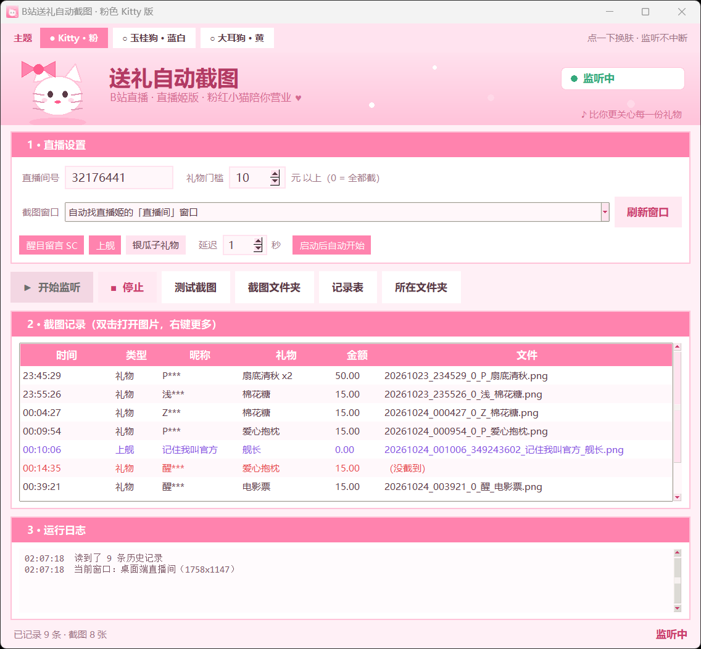

# B站直播 · 送礼自动截图 · 三主题版

观众送礼物 / 上舰 / 发醒目留言时，自动把直播姬窗口（或直播间网页）截一张图，并记一条 CSV。
同一套记录还能在下播后，从直播姬的录制文件里按时间点抽高清帧。

**主播拿到就能用**：解压后双击 `B站送礼自动截图.exe`，不用装 Python、不用装依赖。

[](https://github.com/qiupiao-hub/bili-gift-shot/releases/latest)


> **下载**：到 [Releases](https://github.com/qiupiao-hub/bili-gift-shot/releases/latest) 下 `BiliGiftShot_v1.0.0_win64.zip`，
> 解压后双击里面的 `B站送礼自动截图.exe`（约 68 MB，免安装，Win10/11 64 位）。

三套皮肤点一下即换（监听不中断，选择会记住）：

| 主题 | 配色 | 吉祥物 |
| --- | --- | --- |
| 粉色 Kitty（默认） | 奶油粉 | 白猫 + 粉蝴蝶结 |
| 蓝白玉桂狗 | 云白 + 雾蓝 | 垂耳小白狗 + 蓝丝带 |
| 黄大耳狗 | 奶油黄 | 黄脸 + 棕垂耳 + 贝雷帽 |



```
        ┌────────────┐  礼物/上舰/SC    ┌──────────────┐  延迟 N 秒  ┌─────────────────┐
直播间 ──► blivedm 监听 ├─────────────────► 调度/连击合并 ├────────────► 窗口截图(WGC)  ├──► shots/*.png
        └────────────┘                  └──────────────┘            └─────────────────┘
                                                    └──────────────────► shots/gifts.csv
                                                                              │
下播后：直播姬录制文件 + gifts.csv ──► extract_frames.py ──► 精确到秒的高清截图
```

> 直播姬没有插件接口，拿不到内部礼物事件，所以只能像这样从外部监听直播间。
> 它自带的「礼物答谢」说明礼物事件是有的，只是不对外开放。

---

## 一、打开就能用


**成品包（推荐）**：解压，双击 `B站送礼自动截图.exe`。
单文件程序，第一次启动要解压几秒，之后秒开；不依赖本机 Python。
第一次运行如果弹出 SmartScreen 蓝框，点「更多信息 → 仍要运行」。

**源码包**：双击 `启动.bat`，第一次会建 `.venv` 并装依赖（只有第一次慢），然后弹出界面。

界面上的东西：

| 位置 | 干什么 |
| --- | --- |
| 直播间号 | 填地址栏 `live.bilibili.com/` 后面那串数字 |
| 截图窗口 | 默认「自动找直播姬的直播间窗口」；也可以下拉选具体窗口，或点「刷新窗口」重扫 |
| 礼物门槛 | 多少元以上的礼物才截，填 `0` = 所有礼物都截 |
| 醒目留言 / 上舰 / 银瓜子 | 三类事件分别开关 |
| 延迟 | 收到事件后等几秒再截（等横幅刷出来）；横幅老是拍不中可调 0.6 |
| 启动后自动开始监听 | 勾上以后打开软件就自动开跑，适合开播前固定流程 |

### 换主题

顶上三个胶囊：**粉色 Kitty / 蓝白玉桂狗 / 黄大耳狗**，点一下就换，**监听不会断**。
背景、卡片、表头、按钮、复选框、滚动条、选中高亮全跟着换；吉祥物会眨眼、蝴蝶结轻摆、爱心往上飘。
选择写进 `config.json` 的 `theme`（`kitty` / `cinna` / `pompom`），下次打开还是它。
吉祥物是 Canvas 矢量手绘的，不依赖外部图片，缩放不糊。

点「▶ 开始监听」之后：

- 礼物/上舰/SC 进来会**当场截图**，自动命名 `时间_UID_昵称_礼物.png`，存进 `shots/`
- 列表实时加一行：**双击打开图片**，右键「打开图片 / 打开所在文件夹 / 复制文件路径」
- 关掉再打开，历史记录自动读回来，不用怕丢
- 顶上的「打开截图文件夹」「打开记录表」、右下的「打开所在文件夹」都是一键直达

不用等真的有人送礼也能验证画面：点「测试截图」，立刻截一张看效果。

> 只监听公开的直播弹幕流、只在本机截图，不发送任何消息。

### 不想开界面（可选）

配置也是纯文本，改 `config.json` 一样生效：

```json
{
  "room_id": "123456",          // 你的直播间号
  "window_title": "直播姬|直播间",  // 窗口标题关键字，支持用 | 分隔多个候选
  "min_price_gift": 10        // 礼物门槛（元），0 = 全截
}
```

命令行自测：

```
.venv\Scripts\python.exe gift_shot.py --test-shot     # 立刻截一张，看 shots/_test_*.png
.venv\Scripts\python.exe gift_shot.py --simulate      # 伪造一条礼物，走完"截图+写CSV"
```

---

## 二、截哪个窗口？

| 想留的东西 | 截哪个窗口 | 说明 |
| --- | --- | --- |
| 直播间画面 + 礼物横幅 + 弹幕 | 「直播间」窗口（直播姬里的直播间页 / 直播客户端） | 信息最全，实测一屏能同时拍到礼物提示、弹幕、主播画面 |
| 只有主播画面（皮套/游戏） | 直播姬的预览窗口 | 画面干净，但没有「谁送了什么」 |
| 礼物特效、上舰动画 | 直播间网页（浏览器） | 特效在网页端渲染，直播姬里不显示 |

截图用的是 Windows Graphics Capture：**窗口被其他窗口挡住也能截**，但**最小化就截不到**（Windows 的限制）。
所以把那个窗口放到副屏或后台露一点点，别最小化。

截浏览器网页时，标签栏和书签栏也会进画面。想要干净一点就在浏览器里按 `F11` 全屏，或者用 `crop` 把上下多余的部分裁掉。

---

## 三、配置项（config.json）

| 键 | 默认 | 说明 |
| --- | --- | --- |
| `room_id` | 0 | 直播间号，必填 |
| `window_title` | `夸克` | 窗口标题关键字，`\|` 分隔多候选，取面积最大的匹配（截直播姬就填 `直播姬\|直播间`） |
| `window_hwnd` | 0 | 填了就直接按句柄截，忽略标题 |
| `delay_seconds` | 1.0 | 收到礼物后等几秒再截，等礼物横幅/特效刷出来。网速慢可调 1.5–2 |
| `min_price_gift` | 10.0 | 金瓜子礼物金额门槛（元），低于它的不截 |
| `include_silver_gift` | false | 是否截银瓜子/免费礼物（小心心连击会刷屏，慎开） |
| `auto_start` | false | 打开界面后是否自动开始监听 |
| `min_price_sc` | 0 | 醒目留言门槛（元） |
| `guard_levels` | [1,2,3] | 上舰等级：1 总督 / 2 提督 / 3 舰长 |
| `capture_gift` / `capture_sc` / `capture_guard` | true | 三类事件分别开关 |
| `crop` | null | 裁剪区域 `[x, y, w, h]`，**物理像素**，见下 |
| `out_dir` | shots | 图片目录 |
| `log_csv` | shots/gifts.csv | 记录文件 |
| `image_format` | png | png 或 jpg（jpg 省空间） |
| `window_timeout_seconds` | 3.0 | 单次截图的超时 |

### 裁剪与缩放（重要）

程序启动时会声明 DPI 感知，所以 `--list-windows` 里的尺寸是**物理像素**（系统缩放 125% 时，窗口逻辑尺寸 1406×918，这里显示 1758×1147）。
WGC 截图会去掉窗口的透明边框，通常比 rect 小十几像素，所以 `crop` 的坐标按**截出来的图**量，不是按窗口位置量。

想裁掉浏览器标签栏、只留直播画面：先 `--test-shot` 截一张，用画图打开看像素坐标，再填 `crop`，例如
`"crop": [20, 90, 1160, 900]`。

### 先只截大额礼物

礼物阈值别设 0。辣条/小心心是连击的，会连着触发；脚本已经按「同一个人 + 同一个礼物」把 1 秒内的连击合并成一次，
但阈值太低还是会很吵。建议 10 元起步，SC 和舰长单独开。

---

## 四、事后补高清图（推荐同时开）

实时截图受限于窗口大小；如果还想要推流原画质，就让直播姬把直播录下来：

1. 直播姬 → 右上角设置 → **直播设置 → 下载设置** → 勾选「每次开启直播都启用录制功能」（录制文件默认在「我的文档」，可改路径）。
2. 直播时本工具照常跑，CSV 里记着每次礼物的**墙上时间**。
3. 下播后，把录制文件拖到 `抽帧.bat` 上：

```
抽帧.bat "D:\Videos\直播姬\xxxx.mp4"
抽帧.bat "D:\Videos\直播姬\xxxx.mp4" --rec-start "2026-10-23 23:00:00" --offset 2
抽帧.bat "D:\Videos\直播姬\xxxx.mp4" --dry-run      # 只算时间，不抽帧
```

- 默认用**录制文件的创建时间**当作第 0 秒，对应 `--rec-start` 可以手动指定。
- 时间对不上就调 `--offset`（正数=往后挪）。礼物横幅通常比事件晚 0.5–2 秒出现，一般 `--offset 1` 更好看。
- 默认在礼物时间点前后各 2 秒、每 1 秒抽一张（`--pad` / `--step` 可调），同一个礼物的几张图放一起挑。
- 输出在 `shots/frames_<视频名>/`，`_map.csv` 记录每个礼物对应哪几张图。

录制文件很大（1080p 一小时几个 GB），抽完帧记得删。

---

## 五、常见问题

**找不到窗口 / 截到别的窗口**
先 `--list-windows` 看完整标题，把关键字写进 `window_title`。标题里有 `|` 时用 `window_hwnd` 直接指定句柄更稳。

**截出来是黑图 / 纯色**
- 窗口最小化了 → 先还原。最小化时 Windows 截不到，本程序会先用 WGC，失败再退回 PrintWindow，最小化时通常还是黑的。
- 开了 HDR / 多显卡（独显直连 + 核显输出）偶尔会黑，先试 `--test-shot` 换个窗口验证。
- 需要 Windows 10 1903 以上。

**弹幕里说送了，但没截图**
- 金额没到 `min_price_gift`（默认 10 元）；
- 是银瓜子礼物且 `include_silver_gift` 为 false；
- 连击被合并成一次了（这是设计如此）；
- 看控制台日志，会打印 `找不到窗口` / `窗口最小化` / `截图失败`。

**截图里显示的礼物和 CSV 记录的对不上**
礼物横幅是滚动替换的，同一秒有好几个人送时，1 秒后再截可能已经换成下一条了。把 `delay_seconds` 调到 `0.6` 更容易拍到正确的那条（太小可能横幅还没出来），调到 `1.5` 则适合横幅出得慢的网络。

**填了房间号但一条事件都没有**
先确认房间在直播中；再确认填的是**直播间 URL 里的那串数字**（`live.bilibili.com/` 后面）——直播姬页面顶部显示的房间号有时和它对不上，一律以 URL 为准。SESSDATA 一般不用填，只有频繁被风控时才需要。

**想让它开机就在后台跑**
把 `run.bat` 的快捷方式丢进「启动」文件夹（`shell:startup`）。注意别在直播姬还没打开时就启动，否则第一笔礼物会因为找不到窗口而跳过。

**双击「启动.bat」没反应 / 闪一下就没了**
先双击 `install.bat`，它会把报错停住给你看。最常见的原因是 Python 没装 **tkinter**（图形界面库）：
本机自带的 `C:\Program Files\Python313` 就没装。`install.bat` 会优先挑带 tkinter 的 3.11/3.12/3.13，
所以装 Python 时记得勾选 **“tcl/tk and IDLE”**。想手动确认：

```
.venv\Scripts\python.exe -c "import tkinter"     # 不报错就行
```

**会不会违规**
只读直播间的公开弹幕流、只在本机截图，不发送任何消息。但截图里可能包含观众昵称/弹幕，往外发请注意隐私。

---

## 六、文件说明

| 文件 | 作用 |
| --- | --- |
| `B站送礼自动截图.exe` | **成品包双击这个**：独立程序，不用装 Python |
| `启动.bat` | 源码包双击这个：没装依赖会先装，然后打开图形界面 |
| `gui.py` | 图形界面（tkinter）：三主题皮肤、设置、监听、记录列表、一键打开文件夹 |
| `gift_shot.py` | 核心：监听 → 截图 → CSV，也能不带界面单独跑 |
| `extract_frames.py` | 按 CSV 从录制文件抽帧 |
| `make_icon.py` | 生成 `app.ico` / `docs/logo.png` |
| `config.json` | 配置（第一次运行自动生成，界面上改的都会存进来） |
| `config.example.json` | 配置模板（`config.json` 不入库，避免泄露自己的直播间号） |
| `install.bat` / `设置.bat` / `run.bat` / `抽帧.bat` | 装依赖 / 命令行向导 / 命令行监听 / 抽帧 |
| `vendor/blivedm/` | 内置的 B 站直播弹幕库（MIT，见 `blivedm_LICENSE.txt`）。PyPI 上那个版本太旧，装不上新版 Python |
| `shots/` | 截图、CSV、抽帧结果 |

命令行参数（都是临时覆盖 config，不改文件）：

```
--setup               设置向导（房间号/窗口/门槛）
--list-windows        列出可见窗口
--test-shot           立刻截一张
--simulate            伪造礼物，端到端自测
--room 123456         临时换直播间
--window "夸克"        临时换截图窗口
--min-price 0         临时改礼物门槛
```

---

## 七、许可证

MIT，见 [LICENSE](LICENSE)。内置的 [blivedm](https://github.com/xfgryujk/blivedm) 同为 MIT，
原始许可证在 `vendor/blivedm_LICENSE.txt`。

## 八、致谢

- [blivedm](https://github.com/xfgryujk/blivedm)：B 站直播弹幕协议实现
- [windows-capture](https://github.com/NiiightmareXD/windows-capture)：Windows Graphics Capture 的 Python 封装
- 三只吉祥物均为 Canvas 矢量手绘，未使用任何外部图片素材
